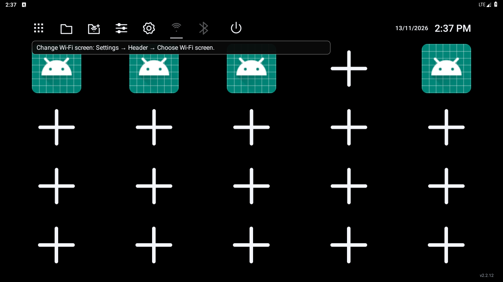
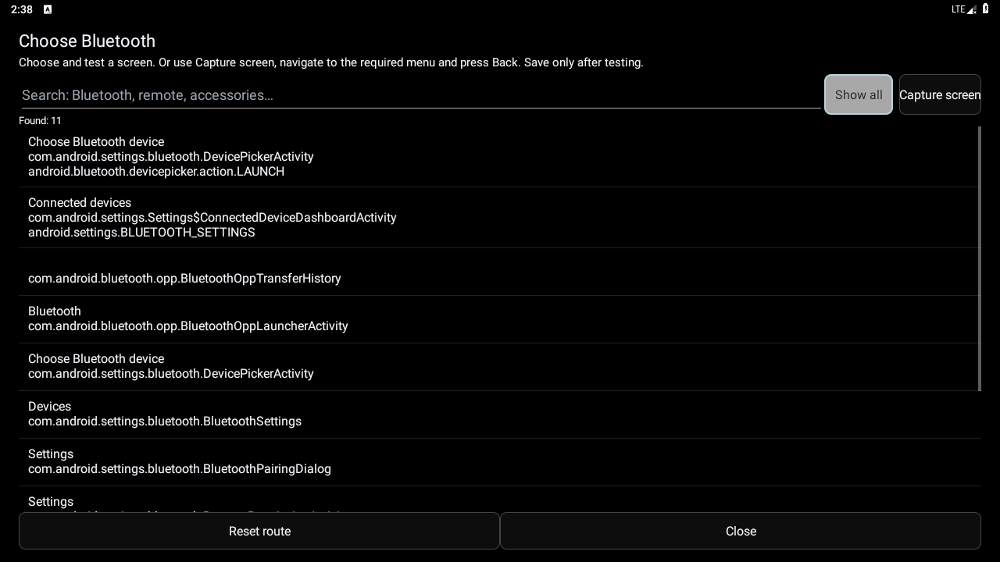

# True TV Launcher

[<kbd>🇷🇺 Русский</kbd>](#русский) &nbsp; [<kbd>🇬🇧 English</kbd>](#english)

## Русский

Лаунчер для Android TV с управлением пультом.

**[Скачать APK 2.2.12](https://github.com/GokSssss/gTVlauncher/releases/download/v2.2.12/2.2.12-True-TV-Launcher.apk)** · [To TV для телефона](https://github.com/GokSssss/gTVlauncher/releases/download/v2.2.12/1.0.4-To-TV.apk) · [Скриншоты](#screenshots)

### Что умеет

- **Рабочий стол:** добавление, замена и перемещение приложений; настройка сетки и оформления.
- **Файлы:** дерево папок, выделение нескольких файлов, копирование, перенос и переименование.
- **Передача с телефона:** файлы, ссылки и текст через **Поделиться → To TV**. Полученный текст можно сохранить в TXT или скопировать в буфер.
- **Верхняя панель:** быстрый доступ к настройкам, Wi-Fi и Bluetooth. Нужный системный экран можно выбрать из списка или запомнить.
- **Приложения:** остановка и перезапуск через включённую службу специальных возможностей.

Проверочный выпуск. Для Obtainium включите **Предварительные выпуски**.

[Помощь](docs/USAGE.md#русский) · [История версий](CHANGELOG.md#русский)

[↑ Русский / English](#true-tv-launcher)

---

## English

A remote-friendly launcher for Android TV.

**[Download APK 2.2.12](https://github.com/GokSssss/gTVlauncher/releases/download/v2.2.12/2.2.12-True-TV-Launcher.apk)** · [To TV for your phone](https://github.com/GokSssss/gTVlauncher/releases/download/v2.2.12/1.0.4-To-TV.apk) · [Screenshots](#screenshots)

### Features

- **Home screen:** add, replace and move apps; adjust the grid and appearance.
- **Files:** folder tree, multiple selection, copy, move and rename.
- **Send from your phone:** files, links and text through **Share → To TV**. Save received text as TXT or copy it to the clipboard.
- **Top bar:** shortcuts to settings, Wi-Fi and Bluetooth. Choose a system screen from the list or capture the one you need.
- **App controls:** stop and restart apps through the enabled Accessibility service.

Preview release. Enable **Pre-releases** in Obtainium.

[Help](docs/USAGE.md#english) · [Version history](CHANGELOG.md#english)

[↑ Русский / English](#true-tv-launcher)

---

## Screenshots

Снимки с тестового эмулятора / Captured on a test emulator.

**Главный экран / Home screen**

**Выбор экрана Bluetooth / Bluetooth screen chooser**

[Документация для разработчика / Developer documentation](docs/DEVELOPMENT.md) · [Проект на Диске / Project on Drive](https://drive.google.com/drive/folders/1HSemiU8S2f8ZPpVLLfJyvjLCbD7PATmn)
