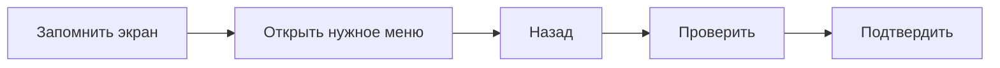
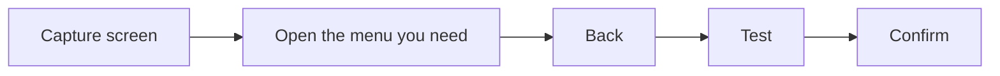

# True TV Launcher

[<kbd>🇷🇺 Русский</kbd>](#русский) &nbsp; [<kbd>🇬🇧 English</kbd>](#english)

## Русский

Лаунчер для Android TV с управлением пультом.

**[Скачать APK 2.2.12](https://drive.google.com/file/d/1E6rSaQXAVWVzrRqkxEqYB1ICiVXQ0WGU/view)** · [Функции и изменения](CHANGELOG.md#русский) · [Скриншоты](#screenshots)

### Что умеет

- **Рабочий стол:** добавление, замена и перемещение приложений; настройка сетки и оформления.
- **Файлы:** дерево папок, выделение нескольких файлов, копирование, перенос и переименование.
- **Передача с телефона:** файлы, ссылки и текст через **Поделиться → To TV**. Полученный текст можно сохранить в TXT или скопировать в буфер.
- **Верхняя панель:** быстрый доступ к настройкам, Wi-Fi и Bluetooth с выбором подходящего системного экрана.
- **Приложения:** остановка и перезапуск через включённую службу специальных возможностей.

### Новое в 2.2.12

**Запоминание экрана Wi-Fi/Bluetooth:** откройте «Настройки лаунчера → Верхняя панель → Выбор экрана».

Кнопки выбора теперь заметно выделяются. Подсказка долгого OK появляется под системными значками, не сдвигая рабочий стол.

Для запоминания нужна включённая служба специальных возможностей. Сеанс ограничен двумя минутами; до подтверждения экран не сохраняется. Доступность конкретной панели зависит от прошивки.

**Передача:** на ТВ сначала откройте приём по значку папки с плюсом и Wi-Fi. Приём работает только пока это окно открыто. [To TV для телефона](https://drive.google.com/file/d/16eJ4u5kGHqbdh19VmT2zXicBtsWX7pZF/view) · [Все файлы проекта](https://drive.google.com/drive/folders/1HSemiU8S2f8ZPpVLLfJyvjLCbD7PATmn).

> 2.2.12 — проверочный выпуск. Поддерживается Android 5.0 и новее; работа отдельных системных панелей зависит от устройства. GitHub-вложения пока недоступны из-за ошибки авторизации; APK доступен по ссылке выше.

[↑ Русский / English](#true-tv-launcher)

---

## English

A remote-friendly launcher for Android TV.

**[Download APK 2.2.12](https://drive.google.com/file/d/1E6rSaQXAVWVzrRqkxEqYB1ICiVXQ0WGU/view)** · [Features and changes](CHANGELOG.md#english) · [Screenshots](#screenshots)

### Features

- **Home screen:** add, replace and move apps; adjust the grid and appearance.
- **Files:** folder tree, multiple selection, copy, move and rename.
- **Send from your phone:** files, links and text through **Share → To TV**. Save received text as TXT or copy it to the clipboard.
- **Top bar:** shortcuts to settings, Wi-Fi and Bluetooth, with a choice of system screens.
- **App controls:** stop and restart apps through the enabled Accessibility service.

### New in 2.2.12

**Capture a Wi-Fi/Bluetooth screen:** open “Launcher settings → Header → Choose screen”.

Chooser buttons now have clear focus. The long-OK hint appears below the system icons without moving the home grid.

Capture requires the enabled Accessibility service. Sessions last up to two minutes; nothing is saved before confirmation. Access to a specific system panel depends on the firmware.

**Transfers:** first open reception on the TV using the folder-plus-Wi-Fi icon. Reception works only while that window is open. [To TV for your phone](https://drive.google.com/file/d/16eJ4u5kGHqbdh19VmT2zXicBtsWX7pZF/view) · [Project files](https://drive.google.com/drive/folders/1HSemiU8S2f8ZPpVLLfJyvjLCbD7PATmn).

> 2.2.12 is a preview release. Android 5.0 or newer is supported; individual system panels depend on the device. GitHub attachments are currently blocked by an authentication error; use the APK link above.

[↑ Русский / English](#true-tv-launcher)

---

## Screenshots

Снимки 2.2.12 с тестового эмулятора / Version 2.2.12 captured on a test emulator.

**Главный экран и временная подсказка / Home screen and temporary hint**

**Выбор экрана Bluetooth и выделение кнопки / Bluetooth screen chooser and button focus**

